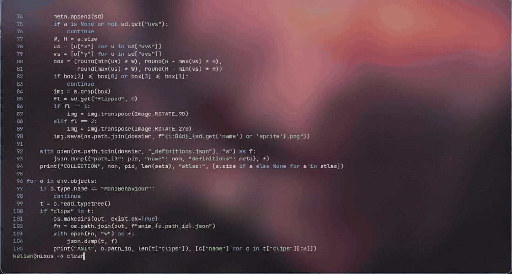

**Français** | [English](docs/en/README.en.md)

# Cera

Cera est un éditeur de texte pour le terminal, écrit en Rust.

<p align="center">
  
</p>

<details open>
<summary><h2>Qu'est-ce que Cera ?</h2></summary>

Cera est un éditeur cli simple à prendre en main. Il est pensé comme une alternative plus moderne et plus intuitive aux éditeurs classiques avec un système de plugins pouvant être écrits en C++, C, Rust, JS, Python permettant d'étendre ou de modifier l'éditeur à son bon vouloir sans modifier le code source.

</details>

<details open>
<summary><h2>Images</h2></summary>

File explorer


Pretty-cat 


et plus

La liste complète des fonctionnalités et des raccourcis est dans l'éditeur : `Ctrl-D`, ou `cera --help` pour les options.

</details>

<details open>
<summary><h2>Installation</h2></summary>

Cera cible Linux (x86_64 et aarch64). Il faut un terminal compatible ANSI ; les couleurs 24 bits sont recommandées (sinon, mettez `true_color` à `false`, voir [Configuration](#configuration)). Les plugins fournis demandent `python3`.

### Avec Nix

```
nix run github:kelian-4/cera       # essayer sans installer
nix profile install github:kelian-4/cera   # installer pour l'utilisateur courant
nix build                          # construire dans ./result (depuis le dépôt)
nix develop                        # shell de développement (depuis le dépôt)
```

Dans une configuration NixOS qui utilise les flakes :

```nix
inputs.cera = {
  url = "github:kelian-4/cera";
  inputs.nixpkgs.follows = "nixpkgs";
};

# dans la liste des modules :
{ environment.systemPackages = [ inputs.cera.packages.${system}.default ]; }
```

Le paquet Nix embarque `python3` pour les plugins fournis.

### Depuis une release (Debian, Ubuntu, Fedora…)

Les paquets (x86_64 et aarch64) sont sur la [page des releases](https://github.com/kelian-4/cera/releases) :

```
sudo apt install ./cera_0.1.0_amd64.deb         # Debian, Ubuntu (arm64 : cera_0.1.0_arm64.deb)
sudo dnf install ./cera-0.1.0-1.x86_64.rpm      # Fedora (aarch64 : cera-0.1.0-1.aarch64.rpm)
```

L'archive contient le binaire et les plugins :

```
tar -xzf cera-0.1.0-linux-x86_64.tar.gz
cd cera-0.1.0-linux-x86_64
./cera                                   # essayer sur place
install -Dm755 cera ~/.local/bin/cera    # installer (vérifiez que ~/.local/bin est dans le PATH)
./plugins/install.sh                     # copier les plugins dans ~/.config/cera/plugins
```

Chaque release contient aussi un fichier `SHA256SUMS` pour vérifier les téléchargements :

```
sha256sum -c SHA256SUMS --ignore-missing
```

### Sur Arch Linux

Un `PKGBUILD` est fourni dans `packaging/aur`. Il construit Cera depuis l'archive de la release `v0.1.0` et lance les tests :

```
git clone https://github.com/kelian-4/cera
cd cera/packaging/aur
makepkg -si
```

### Depuis les sources

Il faut Rust (toolchain stable, avec `cargo`) et `git`. Aucune autre dépendance de construction.

```
git clone https://github.com/kelian-4/cera
cd cera
cargo build --release
cargo test                                       # facultatif
install -Dm755 target/release/cera ~/.local/bin/cera
./plugins/install.sh                             # copie les plugins dans ~/.config/cera/plugins
```

`cargo install --path .` installe aussi le binaire (dans `~/.cargo/bin`) mais pas les plugins : lancez ensuite `./plugins/install.sh`.

### Premier lancement

Au premier lancement, Cera crée `~/.config/cera/config.json` (ou `$XDG_CONFIG_HOME/cera/config.json`) et, quand il trouve les plugins fournis à côté de lui (`../share/cera/plugins` ou `plugins/`), les copie dans `~/.config/cera/plugins` et les active : voir [PLUGINS.md](PLUGINS.md). Vérifiez l'installation avec :

```
cera --version
```

### Mise à jour et désinstallation

- **Mise à jour** : réinstallez la nouvelle version avec la même méthode. Votre `config.json` n'est jamais modifié : une option ajoutée par la nouvelle version garde sa valeur par défaut tant que vous ne l'écrivez pas. Les plugins fournis sont remplacés à chaque changement de version (voir [PLUGINS.md](PLUGINS.md)).
- **Désinstallation** : `sudo apt remove cera`, `sudo dnf remove cera` ou `sudo pacman -R cera` selon la méthode ; pour une installation manuelle, supprimez `~/.local/bin/cera`.
- **Données utilisateur** : la configuration et les plugins copiés restent dans `~/.config/cera` ; supprimez ce dossier pour repartir de zéro.

</details>

<details open>
<summary><h2>Utilisation</h2></summary>

### Sans plugin

```
cera [fichier]
```

### Avec plugin

```
cera [options] [fichier ...]
```

| Option | Effet |
|---|---|
| `-e`, `--explorer [dossier]` | Ouvre l'explorateur de fichiers sur un dossier |
| `-a`, `--afficher fichier...` | Affiche des fichiers en lecture seule, colorés |
| `-f`, `--find nom` | Cherche des fichiers par leur nom |
| `-g`, `--grep motif [chemin...]` | Cherche un texte dans des fichiers et dossiers |
| `-d`, `--diff fichier1 fichier2...` | Compare chaque fichier au premier |
| `-h`, `--help` | Affiche l'aide et la documentation des plugins actifs |
| `-v`, `--version` | Affiche la version |

Les options `-a`, `-f`, `-g` et `-d` sont fournies par des plugins : elles ne fonctionnent que si le plugin est activé.

</details>

<details open>
<summary><h2>Documentation</h2></summary>

- **Dans l'éditeur** : `Ctrl-D` ouvre la documentation complète (raccourcis, plugins actifs) ; `Ctrl-H` affiche ou masque le bandeau d'aide.
- **En ligne de commande** : `cera --help`.
- **Plugins** : [PLUGINS.md](PLUGINS.md) explique comment en utiliser et en écrire.

</details>

<details open>
<summary><h2>Configuration</h2></summary>

Au premier lancement, Cera crée `~/.config/cera/config.json` (ou `$XDG_CONFIG_HOME/cera/config.json`). Ce fichier contient toutes les clés disponibles avec leurs valeurs par défaut. Modifiez-le directement et relancez Cera. Une clé absente garde sa valeur par défaut ; un fichier qui n'est pas du JSON valide est ignoré et toutes les valeurs par défaut s'appliquent.

### Options générales

| Clé | Valeurs | Défaut | Effet |
|---|---|---|---|
| `tab_stop` | entier ≥ 1 | `8` | Largeur d'affichage d'une tabulation, en colonnes |
| `quit_times` | entier | `1` | Avec `1`, quitter (`Ctrl-Q`) avec des modifications non enregistrées demande une confirmation ; avec `0`, Cera quitte sans demander |
| `true_color` | `true` / `false` | `true` | `true` : couleurs 24 bits ; `false` : 256 couleurs, pour les terminaux qui n'affichent pas le 24 bits |
| `show_line_numbers` | `true` / `false` | `true` | Affiche la colonne des numéros de ligne |
| `mouse_enabled` | `true` / `false` | `true` | Active la souris (positionnement du curseur, sélection, molette) |
| `language` | `"fr"`, `"en"`, `"es"` ou `null` | `null` | Langue de l'interface ; `null` : langue du système, puis anglais (voir [Traductions](#traductions)) |
| `indent_guides` | `true` / `false` | `false` | Guides d'indentation, **expérimental** : voir [Fonctionnalités expérimentales](#fonctionnalités-expérimentales) |
| `format_on_save` | `true` / `false` | `false` | Formatage à la sauvegarde, **expérimental** : voir [Fonctionnalités expérimentales](#fonctionnalités-expérimentales) |

### Plugins

| Clé | Valeurs | Défaut | Effet |
|---|---|---|---|
| `plugins.enabled` | liste d'identifiants | `["file-explorer", "pretty-cat", "finder", "diff", "grep"]` | Plugins actifs. Un identifiant est le nom du dossier du plugin. Si la clé est absente, tous les plugins fournis sont actifs |
| `plugins.directory` | chemin ou `null` | `null` | Dossier où chercher les plugins ; `null` : `~/.config/cera/plugins` (ou `$XDG_CONFIG_HOME/cera/plugins`) |

### Thème

Les couleurs se règlent dans la section `theme`, au format `"#RRGGBB"`. Une couleur invalide est ignorée.

| Clé | Défaut | Utilisée pour |
|---|---|---|
| `normal` | `#E8EDF2` | texte courant |
| `comment` | `#8FA3B8` | commentaires |
| `keyword1` | `#82C0FF` | mots-clés principaux |
| `keyword2` | `#8CF5D6` | mots-clés secondaires |
| `string` | `#A8E6CF` | chaînes de caractères |
| `number` | `#C9A8FF` | nombres |
| `type` | `#FFD08A` | types |
| `function` | `#F9A8D4` | fonctions |
| `constant` | `#FF8FA3` | constantes |
| `operator` | `#B4C2D4` | opérateurs |
| `preprocessor` | `#D4E27A` | directives de préprocesseur |
| `variable` | `#FFC6A5` | variables |
| `escape` | `#FFB86B` | séquences d'échappement |
| `match` | `#FFFF66` | résultats de recherche |
| `line_number_fg` | `#7BA3C9` | numéros de ligne |
| `indent_guide` | `#3F4E63` | guides d'indentation |
| `indent_guide_active` | `#7BA3C9` | guide du bloc contenant le curseur |
| `error_fg` | `#FF8A8A` | messages d'erreur |
| `success_fg` | `#9CE89C` | messages de réussite |

Exemple :

```json
{
  "tab_stop": 4,
  "true_color": false,
  "indent_guides": true,
  "theme": { "keyword1": "#ff5555" }
}
```

</details>

<details open>
<summary><h2>Fonctionnalités expérimentales</h2></summary>

Ces fonctionnalités sont **expérimentales**, désactivées par défaut, et peuvent casser des fichiers. Utilisez-les sur des fichiers versionnés.

- `indent_guides` : trace des guides d'indentation.
- `format_on_save` : formate le fichier à la sauvegarde.

```json
{ "indent_guides": true, "format_on_save": true }
```

</details>

<details open>
<summary><h2>Traductions</h2></summary>

L'interface de Cera existe en français, en anglais et en espagnol. La langue est choisie dans cet ordre :

1. la clé `language` de `config.json` (`"fr"`, `"en"` ou `"es"`) ;
2. la langue du système (variables `LC_ALL`, puis `LANG`) ;
3. l'anglais.

Un texte qui manque dans une traduction s'affiche en anglais. La description des plugins (`Ctrl-D`, `cera --help`) est dans la langue de leur manifeste : elle n'est pas traduite.

Pour corriger une traduction ou ajouter une langue, voir « Traductions » dans [CONTRIBUTING.md](CONTRIBUTING.md).

</details>

<details open>
<summary><h2>Structure du dépôt</h2></summary>

```
src/                  code source de l'éditeur
├─ editor/            boucle principale, buffers, annulation, presse-papier
├─ terminal/          mode brut, lecture des touches, souris, collage encadré
├─ syntax/            moteur de coloration et un fichier par langage
├─ format/            formatage à la sauvegarde (expérimental)
├─ plugin/            protocole, sous-processus, découverte des plugins
├─ view/              rendu de l'écran, aide intégrée
├─ io/                configuration, lecture/écriture de fichiers, JSON
└─ i18n/              traductions (fr, en, es)
plugins/              plugins fournis (voir PLUGINS.md)
tests/                tests d'intégration et plugins d'exemple en 5 langages
flake.nix             paquet et environnement de développement Nix
```

</details>

<details open>
<summary><h2>Contribuer</h2></summary>

Voir [CONTRIBUTING.md](CONTRIBUTING.md).

</details>

<details open>
<summary><h2>Signaler un problème</h2></summary>

Cherchez d'abord si le problème est déjà signalé dans les [issues](https://github.com/kelian-4/cera/issues). Sinon, ouvrez-en une en indiquant :

- votre système et votre terminal ;
- la version de Cera (le commit ou la version du paquet) ;
- le contenu utile de votre `config.json` et la liste des plugins actifs (`cera --help`) ;
- les étapes pour reproduire le problème.

</details>

<details open>
<summary><h2>Licence</h2></summary>

Cera est distribué sous licence GNU GPL version 3 ou ultérieure : voir [LICENSE](LICENSE).

</details>
